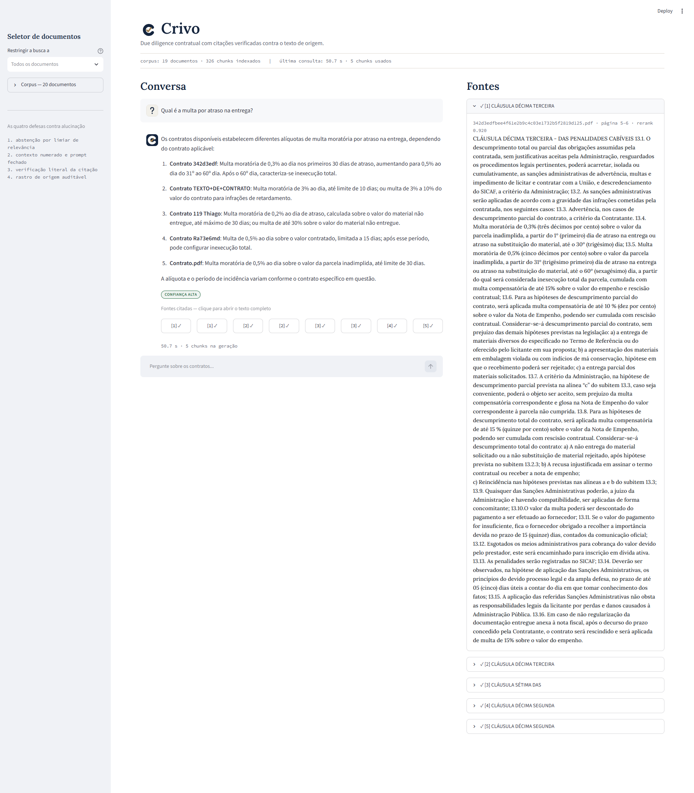
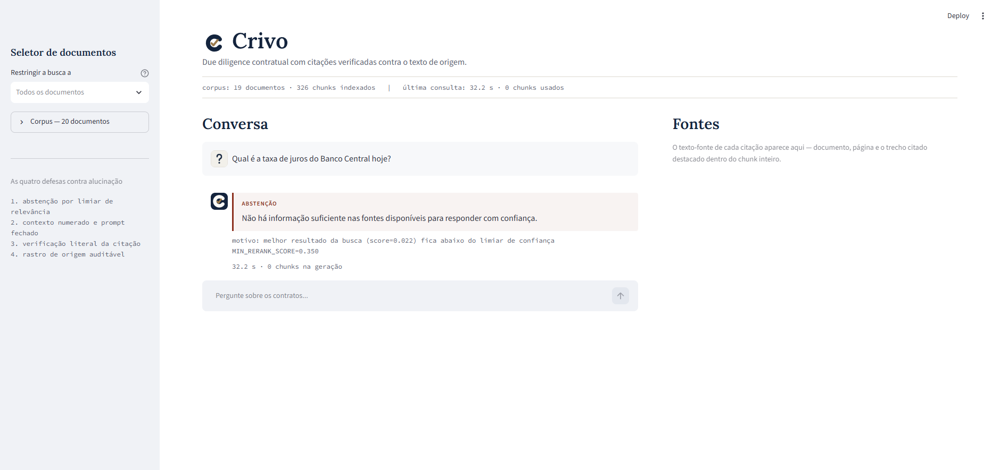
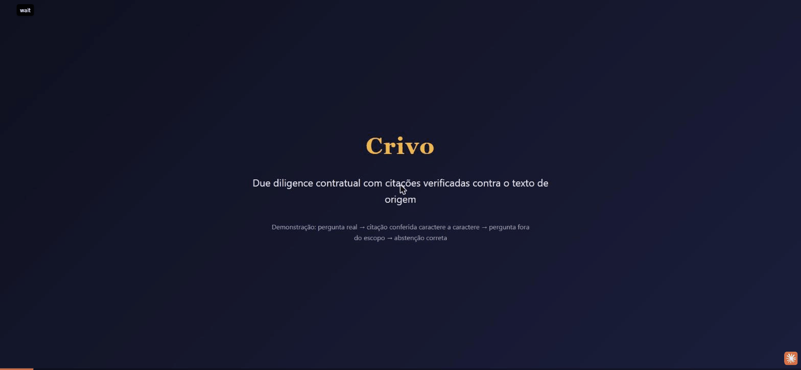
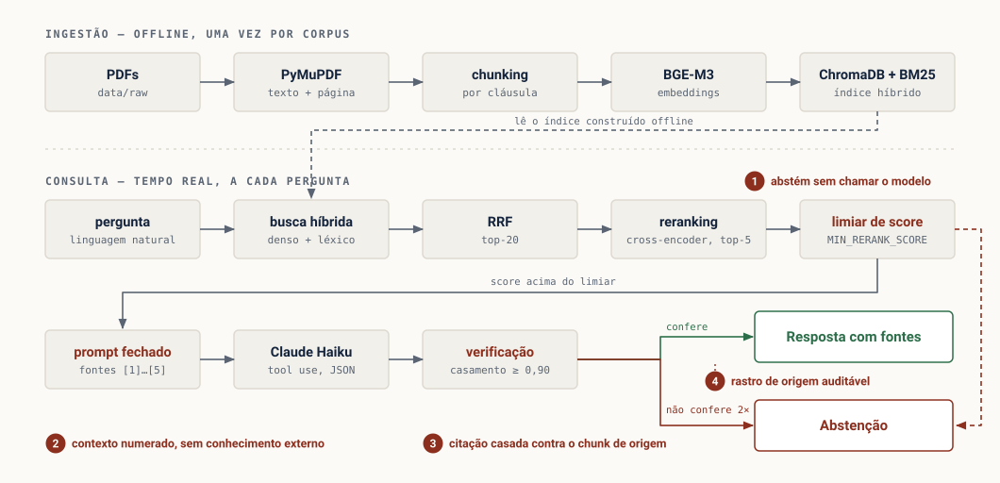

<div align="center">


**Contract due diligence with citations verified against the source text.**

🇺🇸 **English** · 🇧🇷 [Português](README.md)

Answers questions about a corpus of contracts, citing document, clause, page and the literal excerpt — and **refuses to answer** when the answer is not in the documents.


</div>





### Demo



> The interface and the contract corpus are in Brazilian Portuguese (20 real public administrative contracts). The code, docs and this README are explained here in English.

---

## The thesis

Anyone can plug a PDF into a vector store in 40 lines. What almost nobody ships is **proof** that the system does not make things up.

Contract analysis is one of the few places where an AI that hallucinates is worse than no AI. An M&A analyst who receives *"the termination fee is 10% of the contract value"* needs to know **which clause, of which document, on which page** says so — otherwise the answer is worthless, because they have to check everything by hand again.

Most RAG projects solve the easy part (finding similar text) and ignore the hard one (proving the answer came from it). Here the second part **is** the product: every citation the system outputs was matched, character by character, against the chunk it claims to come from. A citation that does not match never reaches the user.

## Results

Measured against a golden set of 50 hand-written questions (30 factual, 10 clause-location, 10 deliberately unanswerable from the corpus), run three times — once per configuration — to isolate the contribution of each pipeline component.

| Configuration | Correct abstention | Citation accuracy | Wrongful abstention | Errors |
|---|---|---|---|---|
| **A** — naive baseline (fixed 512-token chunks, pure dense search) | 100% | 100% | 10.0% | 0 |
| **B** — structural chunking + hybrid search (no reranking) | 100% | 100% | 7.5% | 0 |
| **C** — B + reranking + citation verification (full Crivo) | 100% | 100% | 7.5% | 0 |

**Correct abstention** — of the 10 questions with no answer in the corpus, how many the model correctly refused (ideal: 100%). **Citation accuracy** — of the citations emitted, how many matched the source text character by character (ideal: 100%). **Wrongful abstention** — of the 40 questions with an answer in the corpus, how many the model refused by mistake (ideal: 0%).

Three findings — including ones that do not confirm the initial hypothesis:

- **Zero hallucination across 150 calls** (50 questions × 3 configurations): every emitted citation matched the source text, in every configuration, even the simplest baseline.
- **Hybrid search cuts wrongful abstention by 2.5 pp** over pure dense search (10.0% → 7.5%) — the gain from combining lexical retrieval (BM25) with semantic retrieval.
- **Reranking changed no metric on this corpus** (B → C; 20 documents, 326 chunks): RRF fusion already put the right chunk on top in most queries, leaving no room for the cross-encoder to improve the result. This does not invalidate the technique — it indicates that, on this corpus, the bottleneck was not there. Full reasoning in [`docs/DIARIO_TECNICO.md`](docs/DIARIO_TECNICO.md).

What else is measured, against the real corpus of 20 administrative contracts (326 chunks):

- **10/10 abstentions** on out-of-domain questions in Phase 4, all *before* calling the Claude API, at the relevance-score cutoff — generation cost: zero. ([report](docs/abstencao_fase4.md))
- **9 of 10 queries** where hybrid search + reranking ties or beats pure dense search in Phase 3, with query-by-query analysis of where and why. ([comparison](docs/comparacao_fase3.md))
- **67 green tests**, including the full generation orchestration with a fake `model_caller` — the suite runs in seconds and spends no API tokens.

## How it works



The pipeline has two stages. **Offline**, once per corpus: PDFs are read preserving page numbers, split into chunks **by clause** (not every 512 tokens — a clause cut in half is a rule cut in half), embedded locally with BGE-M3 and indexed in ChromaDB and BM25 at the same time. **In real time**, for each question: search both indexes, fuse with Reciprocal Rank Fusion, rerank with a cross-encoder, and only then — if the best result passes the confidence threshold — the question reaches the model, with numbered sources.

### The four anti-hallucination defenses

| # | Defense | Where it acts | What it prevents |
|---|---|---|---|
| **1** | **Threshold abstention** — if the best chunk falls below the reranker's minimum score, the model is not called | Retrieval | The model "trying to help" with bad context |
| **2** | **Numbered context and closed prompt** — sources enter as `[1]…[5]` with document, clause and page; the instruction forbids outside knowledge | Prompt | Answers based on what the model memorized in training |
| **3** | **Literal citation check** — each quoted excerpt is fuzzy-matched (≥ 0.90) against the source chunk; if it does not match, it was invented | Output | A plausible but fabricated citation |
| **4** | **Source trail** — every citation in the UI opens the full source text with the excerpt highlighted | Interface | Having to trust without being able to verify |

If a citation fails verification, the system reprocesses **once**, telling the model exactly which excerpt did not match. If it fails again, it abstains — because an answer with no confirmed citation is worse than no answer.

## What this project does not do

A portfolio README that only lists strengths is not information. The limitations below are **by design**, and each has a reason:

- **It does not answer cross-document questions** ("compare the penalties of the three contracts"). That requires query decomposition, which is a project in itself. Declared as future work, not hidden behind a partial answer.
- **It does not do OCR.** Scanned PDFs without a text layer are rejected at triage (`scripts/check_corpus.py`), with the characters-per-page metric in plain view. A PDF that enters without text silently pollutes the index — and you only find out three phases later, trying to understand why an obvious question finds nothing.
- **Streaming is progress, not tokens.** The `POST /query/stream` endpoint emits pipeline stages ("searching sources" → "generating answer" → "verifying citations"), not the answer word by word. This is a direct consequence of forcing the output format through *tool use*: the API delivers the validated block whole, not incrementally. Faking token streaming here would misrepresent what the architecture allows.
- **Ingestion job state lives in memory.** Enough for a single-instance API; it does not survive a restart nor is it shared across multiple workers. A real job store (Redis, a table) is the next step for production — but would be disproportionate here.
- **Thresholds were validated, not optimized.** The values in `.env.example` came from the distribution observed over 10 queries (Phase 3) and held up on the 50 golden-set questions of Phase 7 — but were never put through a systematic search (grid search) over the hyperparameter space. That is the difference between "did not fail the tests" and "is the optimum".

## Run locally

> Quick-reference guide with a table of common errors (in Portuguese): **[`docs/COMO_RODAR.md`](docs/COMO_RODAR.md)**.

### Prerequisites

- Python 3.11 or higher
- A [Claude API](https://console.anthropic.com/settings/keys) key **tied to a workspace** (an organization-level key is rejected with `not scoped to a workspace`)
- Docker Desktop (optional, for the containerized path)

### 1. Install

**Windows (PowerShell)**

```powershell
python -m venv .venv
.venv\Scripts\Activate.ps1
pip install -e ".[dev]"
copy .env.example .env
notepad .env          # paste your ANTHROPIC_API_KEY
```

**Linux / macOS**

```bash
python3 -m venv .venv
source .venv/bin/activate
pip install -e ".[dev]"
cp .env.example .env
```

### 2. Build the index from your corpus

Put the PDFs in `data/raw/` and run, in order:

```bash
python scripts/check_corpus.py           # PDF triage, generates manifest.csv
python -m rag.ingest.pipeline --verbose  # structural chunking -> data/processed/chunks.jsonl
python -m rag.ingest.indexer             # embeddings + BM25 -> data/chroma/
```

On the first run, BGE-M3 and the reranker are downloaded (~2.5 GB combined). After that everything runs locally and offline — only answer generation uses the network.

```bash
python -m rag.retrieval.cli "multa por atraso na entrega"    # search only
python -m rag.generation.cli "multa por atraso na entrega"   # search + verified answer
```

### 3. Start the API and the interface

```bash
uvicorn rag.api.main:app --reload   # API on :8000, docs at /docs
streamlit run ui/app.py             # interface on :8501
```

### 4. Run the tests

```bash
pytest -q
```

### Docker path

```bash
docker compose up --build
```

Assumes step "2. Build the index from your corpus" has already been done — Compose starts the API and the UI, not ingestion.

> **Windows:** the `Makefile` is a shortcut for people who have `make`. Without it, use the full commands above — they are exactly what each Makefile target runs.

## Technical decisions

This project documents the **why** of each decision, not just the how (the documents are in Portuguese):

- **[`docs/PLANO.md`](docs/PLANO.md)** — the nine phases, with a binary acceptance criterion per phase, the trade-off table for each layer (and what was discarded), and the risks with their mitigations.
- **[`docs/DIARIO_TECNICO.md`](docs/DIARIO_TECNICO.md)** — the development log: the concepts behind each choice, three real bugs found with real data (one of which only showed up on another machine, because of Python's `hash()` randomization) and the reasoning behind each trade-off.
- **[`docs/comparacao_fase3.md`](docs/comparacao_fase3.md)** — dense vs. hybrid + reranking search, 10 queries, case-by-case analysis.
- **[`docs/abstencao_fase4.md`](docs/abstencao_fase4.md)** — the 10 out-of-corpus questions and what the result proves (and what it still does not).
- **[`docs/IDENTIDADE.md`](docs/IDENTIDADE.md)** — the visual system: palette, typography and rules for semantic color use.

## Structure

```
sistema-rag/
├── assets/             logo, favicon and the architecture diagram
├── data/
│   ├── raw/            original PDFs + manifest.csv   (outside git)
│   ├── processed/      chunks.jsonl                   (outside git)
│   └── chroma/         persisted vector index         (outside git)
├── src/rag/
│   ├── settings.py     central configuration — every constant lives here
│   ├── ingest/         Phase 2 — parsing and clause chunking
│   ├── retrieval/      Phase 3 — hybrid search and reranking
│   ├── generation/     Phase 4 — generation and citation verification
│   ├── api/            Phase 5 — FastAPI
│   └── eval/           Phase 7 — golden set and metrics
├── ui/app.py           Phase 6 — Streamlit interface
├── scripts/            command-line utilities
├── tests/              67 tests, none spends an API call
└── docs/               plan, technical log and per-phase reports
```

## Roadmap

| Phase | Deliverable | Status |
|---|---|---|
| 0 | Repository foundation, `/health` API, Docker | ✅ |
| 1 | Corpus: 20 real public contracts + manifest | ✅ |
| 2 | Parsing and structural clause chunking | ✅ |
| 3 | Hybrid index and reranking | ✅ |
| 4 | Generation with verified citation | ✅ |
| 5 | Complete API | ✅ |
| 6 | Interface with source audit | ✅ |
| 7 | Evaluation suite — 50-question golden set | ✅ |
| 8 | Packaging and presentation | ⬜ |

## License

MIT.
